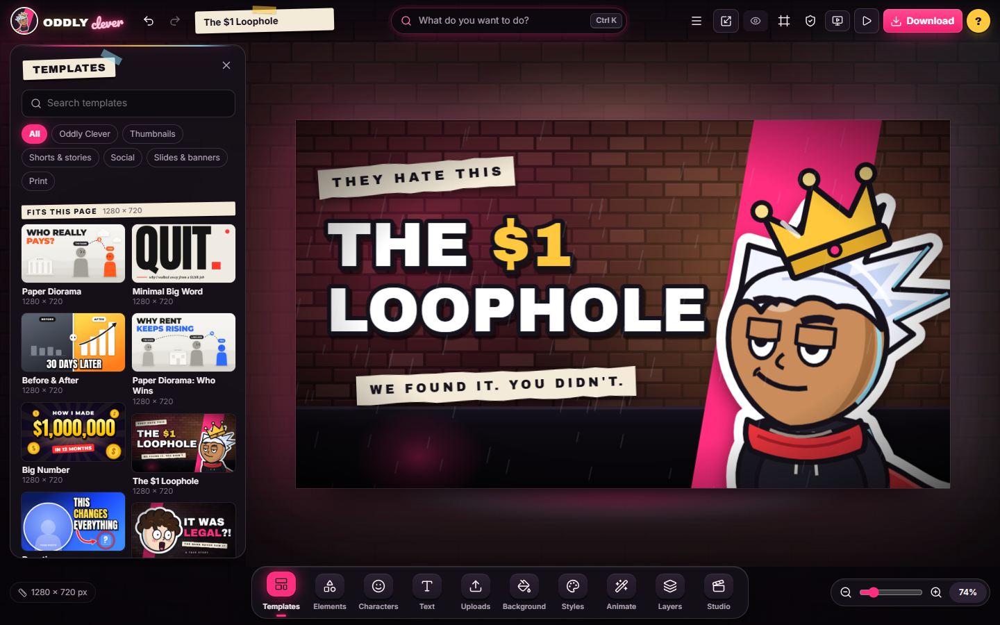
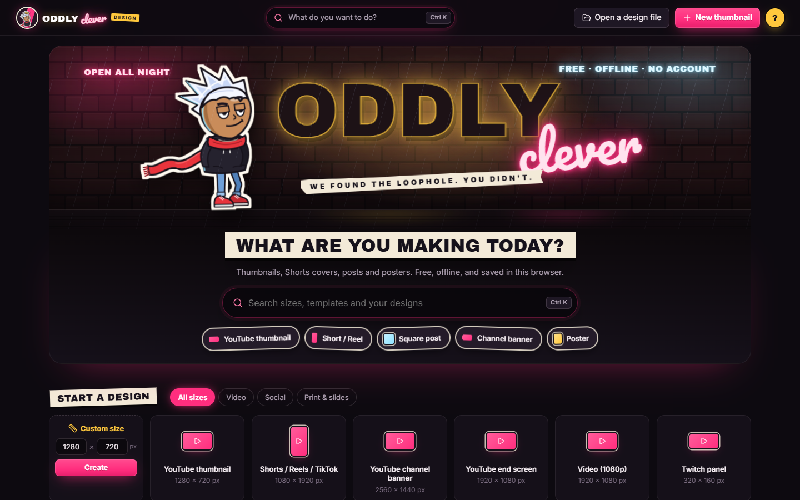
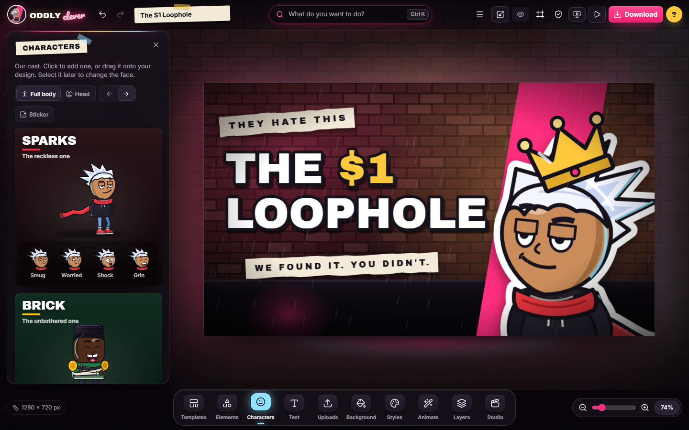
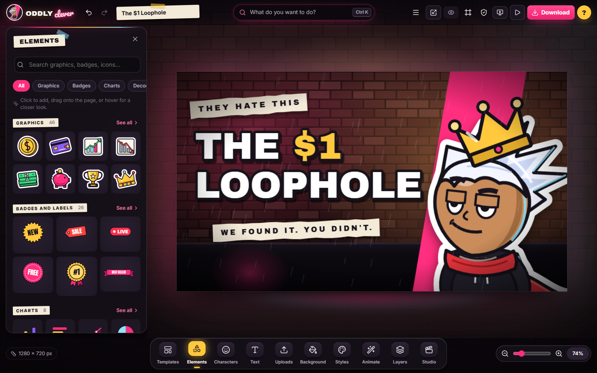
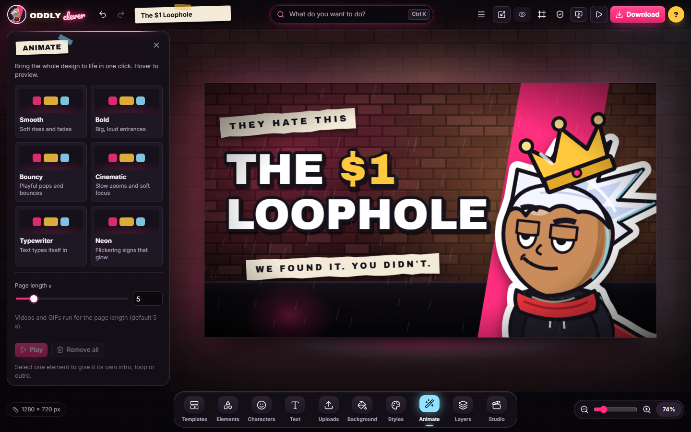
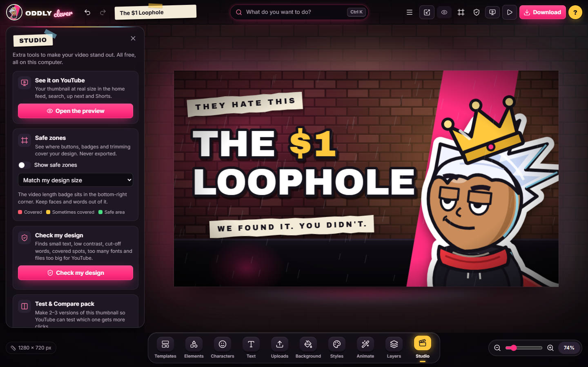

# OddlyClever Design

I got sick of paying every month just to cut someone out of a photo. So I built my own design app.

It's free, it runs in your browser, and you don't make an account. Make YouTube thumbnails, Shorts covers, social posts, slides and posters. It works offline once it's loaded, there's no server, and nothing you make leaves your computer.

**Use it now: [oddlyclevertools.github.io/OddlyCleverDesign](https://oddlyclevertools.github.io/OddlyCleverDesign/)** (Chrome or Edge on a PC works best: the background remover and video export use your graphics card.)

See it working: [the walkthrough on YouTube](https://youtu.be/JW7PvwJSv5A)

[](https://ko-fi.com/oddlyclevertools)



## What it does

- **Ask AI (bring your own AI).** Type what you want and an AI builds it on your page, step by step, with one-click Undo AI. Works with Claude (first), OpenAI, Gemini, OpenRouter, Groq, Mistral and DeepSeek with your own key, free local models on your PC (Ollama, LM Studio, llama.cpp), or with no key at all by pasting into any AI chat. The AI uses the same 29 design tools you do: it reads the page size and every object's box, looks at a picture of the page, and anything it places past the edge is pulled back onto the page with a note saying what moved.
- **Design in a style you like.** Drop, paste or pick up to 5 thumbnails whose look you like, and the AI rebuilds that style (layout, headline, colours, mood) with your own words, cast and fonts. It never copies the pictures themselves. The app measures each picture on your PC first (exact colours, accent, where the subject and empty space are), so even small AI models get precise numbers. Save sets as **My styles** ("my channel look") to reuse with one click. Choose how hard the AI thinks, from Quick to Max.
- **Real pictures.** The AI can search **My folders** (picture folders on your PC you allow it to read) and place your own art and photos, make new pictures with your image AI (B.AI or OpenAI image models, with a limit you choose, 4 to 20 per 10 minutes, to protect your credit), and give any picture a photo look: polaroid with a handwritten caption, split cyan/red light, black and white with grain, or noir.
- **Collages.** The AI fills a whole collage in one step (for example the "UK vs INDIA" layout: two panels, a tall middle, two panels), cropping every picture around its subject. It can keep the same made-up person or place across panels by sending earlier pictures to the image AI as references.
- **The AI draws, too.** It can draw new vector art the way a designer draws in code (characters, props, icons, maps, badges), and every shape stays editable. Flag and other emoji show in colour in every font, the same on every computer.
- **My library.** Save any design as a template (Templates, My templates) and any selection as an element (Elements, My elements). The AI can save its work there too and reuse yours.
- **Pages and Present.** Up to 100 pages per design with a page strip, Present mode (fade or slide, animations, laser pointer, a presenter window with notes, timer and next page), and Smart resize to one or many sizes at once (it keeps the subject and headline big and text out of each platform's overlays).
- **Background remover on your GPU.** One click cuts the person or product out of a photo in under a second, on your own graphics card (WebGPU), free and offline after a one-time model download. "Subject on its own layer" keeps the photo, so a headline can sit behind the person.
- **Magic photo edits.** Magic Eraser and Magic Grab are free and run on your GPU (an MIT-licensed eraser model, about 0.1 s per erase). Magic Edit ("make the jacket red") and Magic Expand (grow a photo to 16:9, 9:16 or any shape) use your image AI. Each one says up front whether it's free or spends an AI picture, pixels outside the edit stay exactly the same, and a before/after slider and Restore original are always there.
- **Free stock photos and videos** from Pexels, Pixabay and Openverse, with only licences that allow commercial use, and the credits kept with the design automatically ("Copy all" for your description).
- **Video editor.** Auto captions made on your GPU (Whisper, word by word) in 7 styles you can edit, a blurred fill or free reframe for landscape clips in Shorts, J/K/L and Q/W keys, speed from 0.1 to 10× with pitch kept, reverse and freeze frame, and 8 transitions. A timeline under the page with video, voice-over, music, sound effects and captions: trim, split, fades, speed, transitions, picture-in-picture, music that ducks under your voice, beat detection with "snap scene changes to the beat", and MP4 export (H.264 + AAC, 1080p or 4K, vertical for Shorts) on your graphics card's video encoder.
- **Bulk create** from a table (paste, CSV or Excel): link `{{columns}}` to text and pictures, preview every row with problem flags (text too long, low contrast, missing pictures), and make separate designs, pages or a ZIP of pictures.
- **Translate** a design into 36 languages with your AI, with right-to-left layout and font checks.
- **Share as files, no server:** a single offline `.html` viewer, the `.ocd` design, or a review copy where others drop comment pins and send them back.
- **Content planner.** A posting calendar (month and week) with your repeating slots, ideas, linked designs per platform, and a one-click upload kit: every picture at each platform's size, title, description with credits, tags and a checklist (including the AI-content label reminder). It never posts for you.
- **Connect Claude.** A small connector (in `connector/`) lets Claude Desktop, Claude Code or any MCP app build in your open tab, using your normal Claude plan. See [connector/README.md](connector/README.md).

- **Our own studio.** A neon-night stage, a tool dock, paper-label panels, and Ctrl+K "What do you want to do?" search over every tool, size and template.
- **Beginner friendly.** A "What are you making today?" start, a short tour, tips, and plain words everywhere.
- **The Oddly Clever cast:** Sparks, Brick, Milo, Rae and the Keeper as posable stickers, with expressions, facing, head-only and a die-cut outline.
- **84 templates.** Thumbnails, Shorts covers, posts, carousels, slide decks, banners, business cards, invitations, menus, posters and infographics, including an Oddly Clever pack.
- **Elements:** 46 illustrations, 26 editable badges, 30 decorations, 36 backgrounds and scenes, 8 editable charts, photo grids, shapes, lines, stickers, frames and every Lucide icon.
- **Text:** 35 fonts plus your own uploads, 55 presets, 14 effects and curved text. Style just one word (colour, weight, size, highlight, or one-click Pop), every weight a font has (up to Black 900), shrink to fit, and a font picker with live preview and favourites. Colours: gradients (linear or radial, up to 5 stops), an eyedropper, your brand colours, and recent colours.
- **Styles:** 34 palettes that restyle a whole design in one click (with Shuffle), 25 font pairings and a free brand kit.
- **Animation:** 24 element animations, 6 one-click page styles, a live preview, and MP4 (hardware video encoder) and GIF export.
- **Studio** (things Canva lacks or charges for): a YouTube feed preview at real size with a squint test, safe zones, "Check my design" with one-click fixes, A/B variant packs for Test & Compare, and version history.
- **Photos:** edit the background photo (blur, darken, filters, move), crop with ratio presets, straighten and a thirds grid, 13 adjustments with Auto-enhance and hold-to-compare, and drop a new photo onto a selected one to replace it.
- **Arrange and export:** layers, smart guides, rulers and undo/redo. Export to PNG, JPG, WebP (1×/2×/4×, with a size target and a size estimate, pick any pages), PDF, SVG (text effects and curved text kept), MP4 and GIF, copy as an image, and save `.ocd` design files. 36 size presets.

| Home | Characters | Elements | Animate | Studio |
|---|---|---|---|---|
|  |  |  |  |  |

## Run it on your own PC

You don't need to, the link above is the whole app. But if you want to change it, you need [Node.js](https://nodejs.org) 20 or newer.

```bash
npm install
```

```bash
npm run dev
```

Then open http://localhost:5181.

To build the static site into `dist/` (it can be hosted anywhere, including GitHub Pages, because paths are relative):

```bash
npm run build
```

## Tests

- Unit tests (vitest): `npm test`
- End-to-end tests (Playwright, with your installed Chrome): `npm run e2e`

The end-to-end test makes a thumbnail through the real UI, edits it, undoes and redoes, downloads a PNG and checks its size, then reopens it from the home screen. It also checks that every template builds.

## Privacy

Everything runs locally. Fonts and icons are bundled. The app makes no network requests at run time, except: the background-remover and eraser models are downloaded once from huggingface.co after you say yes; stock searches send your search words to the photo sites you pick (the Photos panel names them); and when you press Send in Ask AI with a cloud AI: then your request and a picture of your design go straight from your browser to that AI's company (the panel says where before the first send). Local models and the Claude connector stay on your PC.

Style pictures you attach are sent to the AI only with that request; saved styles stay in this browser. When the AI makes a picture, the description (and, for "the same person as", the earlier pictures it names) goes to your image AI. Your library (My templates, My elements) stays in this browser. API keys stay in memory unless you tick "Remember on this computer" (then in this browser's IndexedDB). They never go into designs, `.ocd` files, exports, autosave or version history. "Forget key" removes them. Designs and uploads are stored in your browser's IndexedDB, which is cleared if you clear site data for the app. Download `.ocd` files to keep copies.


## Licence

MIT. Use it for anything, paid client work included, and change it however you like. See [LICENSE](LICENSE). Third-party parts are listed in [THIRD_PARTY.md](THIRD_PARTY.md).

The licence covers the code. The Oddly Clever name, logo and characters (Sparks and the crew) stay with Oddly Clever Tools: if you fork it, give it a new name and look. Details in [TRADEMARKS.md](TRADEMARKS.md).

OddlyClever Design copies the idea of an online design editor, not anyone's code, templates, artwork or branding. Every template, sticker and shape in it was made for this project.

## Something broken?

Open an issue and tell me. I read every one. If it saved you a subscription, [a tea](https://ko-fi.com/oddlyclevertools) keeps the next tool coming.
